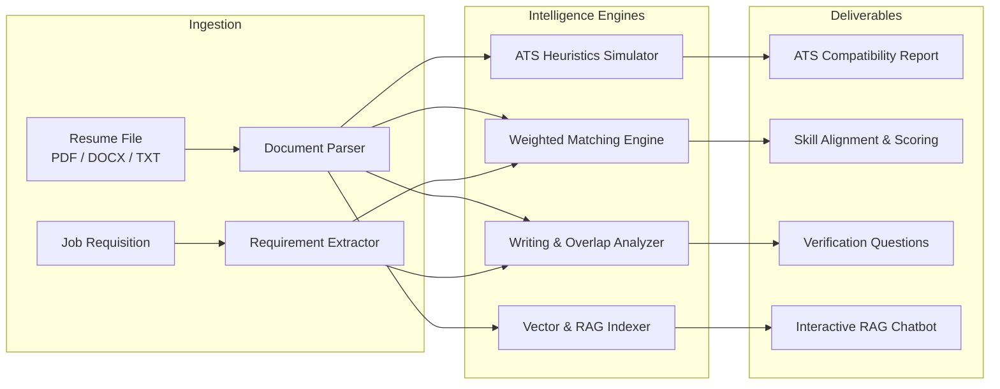

# Smart Resume Analyzer

[](https://nexusresumeanalyzer.web.app)
[](https://nextjs.org/)
[](https://www.typescriptlang.org/)
[](https://tailwindcss.com/)
[](https://github.com/ReasonableExcuses/Resume)
[](LICENSE)

An enterprise-grade resume intelligence platform providing ATS compatibility simulation, contextual job matching, AI writing verification, and document-grounded Retrieval-Augmented Generation (RAG) conversational querying.

**Live Deployment:** [https://nexusresumeanalyzer.web.app](https://nexusresumeanalyzer.web.app)

---

## System Architecture



---

## Core Capabilities

| Capability | Technical Approach | Outcome |
|---|---|---|
| **Contextual Job Matching** | 5-category weighted scoring (Skills 35%, Experience 25%, Responsibilities 15%, Education 10%, Projects 15%) | Objective 0–100 match index with strong, partial, missing, and transferable classifications |
| **ATS Compatibility Simulator** | Heuristic inspection of multi-column streams, tables, frames, contact placement, and encoding | Identifies document parsing bottlenecks with a linear text stream preview |
| **AI Writing Review** | N-gram phrase overlap detection and cliché density profiling | Generates interviewer verification prompts without punitive or ungrounded accusations |
| **Document RAG Chatbot** | Semantic text chunking with hybrid keyword/vector search and stop-word filtering | Verifiable answers citing exact document sections and page numbers |
| **Candidate Comparison** | Multi-candidate matrix across uniform job requisitions | Side-by-side screening with built-in fair hiring compliance notices |

---

## Technical Stack

- **Framework**: Next.js 16 (App Router, Turbopack)
- **Language**: TypeScript 5
- **Styling**: Tailwind CSS
- **Visualization**: Recharts, SVG Gauge Primitives
- **Document Ingestion**: `pdf-parse`, `mammoth`
- **Testing**: Node.js Test Runner with `tsx`

---

## Quickstart

### Prerequisites
- Node.js 18.0.0 or higher
- npm 9.0.0 or higher

### Installation
```bash
git clone https://github.com/ReasonableExcuses/Resume.git
cd Resume
npm install
```

### Development
```bash
npm run dev
```
Navigate to `http://localhost:3000`.

### Testing
```bash
npm test
```
Executes the automated test suite covering parsers, match algorithms, ATS heuristics, and RAG retrieval.

### Production Build
```bash
npm run build
npm start
```

---

## REST API Reference

| Method | Endpoint | Description |
|---|---|---|
| `POST` | `/api/resumes/upload` | Ingest and parse PDF/DOCX file (10MB limit) |
| `GET` | `/api/resumes` | Retrieve stored candidate records |
| `GET` | `/api/resumes/:id` | Fetch specific resume metadata |
| `DELETE` | `/api/resumes/:id` | Purge candidate document and linked records |
| `POST` | `/api/analyses` | Execute end-to-end analysis pipeline |
| `GET` | `/api/analyses/:id` | Retrieve comprehensive analysis record |
| `GET` | `/api/analyses/:id/report` | Export structured JSON analysis report |
| `POST` | `/api/ats/check` | Standalone ATS layout compatibility audit |
| `POST` | `/api/writing-insights/analyze` | Standalone stylistic and phrase overlap audit |
| `POST` | `/api/chat/sessions/:id/messages` | Query document RAG engine with evidence citations |
| `POST` | `/api/candidates/compare` | Evaluate multiple resumes against a target job requisition |

---

## Security and Ethics Principles

1. **Untrusted Input Sanitation**: All uploaded documents are treated strictly as structured text input, neutralizing execution and prompt injection vectors.
2. **Responsible AI Review**: Stylistic reviews highlight areas requiring human validation rather than inferring automated dishonesty.
3. **Session Data Isolation**: Records are bound to authenticated or local demo sessions with user-directed purge capabilities.
4. **Fair Hiring Guardrails**: Prohibits filtering by demographic, photographic, or protected attributes.

---

## License

Released under the MIT License.
